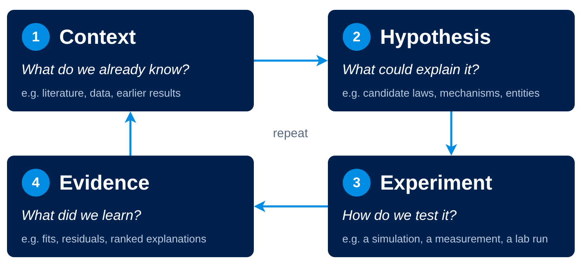
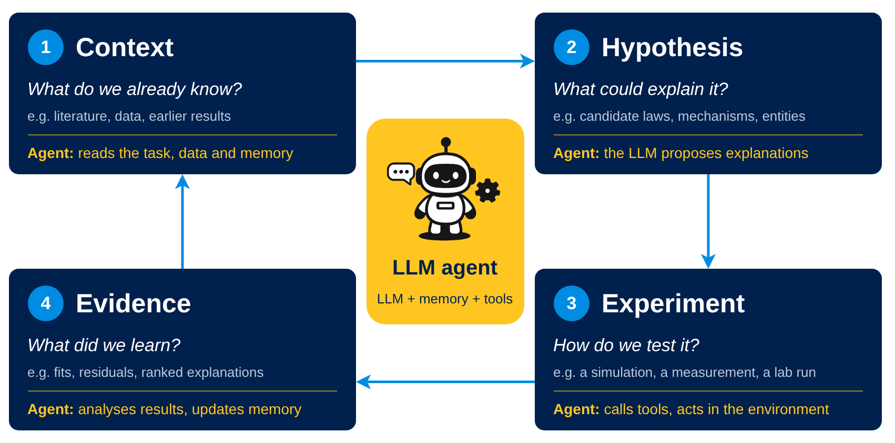
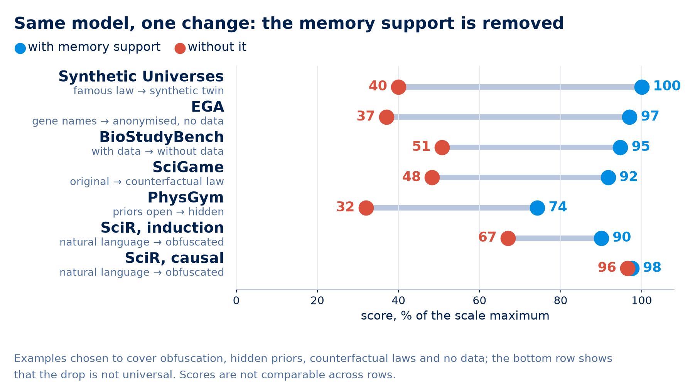

# Бенчмарки научного открытия для LLM-агентов

Что они измеряют, как оценивают, где пробелы и что нужно хорошему бенчмарку

Марк Зарецкий

Do Androids Dream of Electric Papers? · Манчестер, 25 ноября 2026

<!--
Обзор (числа на 23.11.2026): 439 работ в списке бенчмарков; 296 классифицированы по единой схеме
(classification/), из них 81 разобраны по полному тексту; 103 из 296 — бенчмарки открытия (самый глубокий
требуемый ответ: fit 19, law 40, mechanism 40, structural 4); график на слайде 2 считает ровно эти 103.
Главный вопрос доклада: можно ли по существующим
бенчмаркам отличить агента, который выбирает объясняющую гипотезу, от агента,
который подгоняет данные или вспоминает учебник.
-->

---

## Классический научный цикл

---

## Агент внутри цикла

---

## 1. Что мы называем эпистемическими способностями

omniscale-ai.github.io/epistemic_benchmarks

Открытие — это цепочка шагов, а не один ответ:

1. **Заметить аномалию**: известная теория T0 перестала работать
2. **Выдвинуть альтернативы**, в том числе ненаблюдаемую сущность (скрытая планета)
3. **Спланировать различающий эксперимент**: такой, где гипотезы расходятся
4. **Предсказать до измерения** и зафиксировать предсказание
5. **Пересмотреть доверие** пропорционально силе свидетельства
6. **Вывести новое предсказание** из механизма, а не продолжить подогнанную кривую
7. **Знать границы применимости** найденного закона
8. **Не подменять вывод памятью**

Это рамка, по которой дальше разбираются бенчмарки: какие шаги они видят, а какие нет.

**Мы изучили 103 бенчмарка открытия.** По областям (один бенчмарк может относиться к нескольким): физика 31, биология 28, медицина 12, материалы 12, химия 11, науки о Земле 9, математика 9, социальные науки и экономика 9, астрономия 7, а также игры, анализ данных, программная инженерия и задачи общего назначения.

---

## 2. Как развивалась область: пять этапов

omniscale-ai.github.io/epistemic_benchmarks

<!-- _footer: "Полные ссылки на все бенчмарки, названные на этом слайде: см. Приложение." -->

<svg class="tl-svg" width="1168" height="484" viewBox="0 0 1168 484" xmlns="http://www.w3.org/2000/svg" font-family="inherit"><polyline points="308.8,426 308.8,352 112.0,314" fill="none" stroke="#4F6D99" stroke-opacity=".75" stroke-width="1.3"/><rect x="300.8" y="426" width="499.2" height="12" rx="3" fill="#4F6D99"/><circle cx="308.8" cy="432.0" r="4" fill="#fff"/><text x="788.0" y="436.0" font-size="10.5" font-weight="700" fill="#fff">1</text><polyline points="854.0,410 854.0,352 348.0,314" fill="none" stroke="#008CE3" stroke-opacity=".75" stroke-width="1.3"/><rect x="846.0" y="410" width="184.0" height="12" rx="3" fill="#008CE3"/><circle cx="854.0" cy="416.0" r="4" fill="#fff"/><text x="1018.0" y="420.0" font-size="10.5" font-weight="700" fill="#fff">2</text><polyline points="946.0,394 946.0,352 584.0,314" fill="none" stroke="#00A987" stroke-opacity=".75" stroke-width="1.3"/><rect x="938.0" y="394" width="92.0" height="12" rx="3" fill="#00A987"/><circle cx="946.0" cy="400.0" r="4" fill="#fff"/><text x="1018.0" y="404.0" font-size="10.5" font-weight="700" fill="#fff">3</text><polyline points="1038.0,378 1038.0,352 820.0,314" fill="none" stroke="#FFC622" stroke-opacity=".75" stroke-width="1.3"/><rect x="1030.0" y="378" width="60.0" height="12" rx="3" fill="#FFC622"/><circle cx="1038.0" cy="384.0" r="4" fill="#fff"/><text x="1078.0" y="388.0" font-size="10.5" font-weight="700" fill="#00204D">4</text><polyline points="1098.0,362 1098.0,352 1056.0,314" fill="none" stroke="#DB4F3D" stroke-opacity=".75" stroke-width="1.3"/><rect x="1090.0" y="362" width="60.0" height="12" rx="3" fill="#DB4F3D"/><circle cx="1098.0" cy="368.0" r="4" fill="#fff"/><text x="1138.0" y="372.0" font-size="10.5" font-weight="700" fill="#fff">5</text><line x1="20" y1="454" x2="758" y2="454" stroke="#00204D" stroke-width="2"/><line x1="786" y1="454" x2="1164" y2="454" stroke="#00204D" stroke-width="2"/><polygon points="1166,454 1158,450 1158,458" fill="#00204D"/><line x1="764" y1="448" x2="772" y2="460" stroke="#00204D" stroke-width="2"/><line x1="776" y1="448" x2="784" y2="460" stroke="#00204D" stroke-width="2"/><line x1="20.0" y1="450" x2="20.0" y2="458" stroke="#00204D" stroke-width="1.5"/><text x="20.0" y="472" font-size="12" text-anchor="start" fill="#004381" font-weight="400">1950</text><line x1="280.0" y1="450" x2="280.0" y2="458" stroke="#00204D" stroke-width="1.5"/><text x="280.0" y="472" font-size="12" text-anchor="middle" fill="#004381" font-weight="400">1975</text><line x1="540.0" y1="450" x2="540.0" y2="458" stroke="#00204D" stroke-width="1.5"/><text x="540.0" y="472" font-size="12" text-anchor="middle" fill="#004381" font-weight="400">2000</text><line x1="800.0" y1="450" x2="800.0" y2="458" stroke="#00204D" stroke-width="1.5"/><text x="800.0" y="472" font-size="12" text-anchor="middle" fill="#004381" font-weight="700">2021</text><line x1="846.0" y1="450" x2="846.0" y2="458" stroke="#00204D" stroke-width="1.5"/><text x="846.0" y="472" font-size="12" text-anchor="middle" fill="#004381" font-weight="700">2022</text><line x1="892.0" y1="450" x2="892.0" y2="458" stroke="#00204D" stroke-width="1.5"/><text x="892.0" y="472" font-size="12" text-anchor="middle" fill="#004381" font-weight="700">2023</text><line x1="938.0" y1="450" x2="938.0" y2="458" stroke="#00204D" stroke-width="1.5"/><text x="938.0" y="472" font-size="12" text-anchor="middle" fill="#004381" font-weight="700">2024</text><line x1="984.0" y1="450" x2="984.0" y2="458" stroke="#00204D" stroke-width="1.5"/><text x="984.0" y="472" font-size="12" text-anchor="middle" fill="#004381" font-weight="700">2025</text><line x1="1030.0" y1="450" x2="1030.0" y2="458" stroke="#00204D" stroke-width="1.5"/><text x="1030.0" y="472" font-size="12" text-anchor="middle" fill="#004381" font-weight="700">2026</text></svg>

1Закон из таблицы

1977–2021

BACON, Eureqa, AI Feynman, SRBench

<b>Вход: </b>таблица чисел из формулы

<b>Выход: </b>формула

<b>Оценивается: </b>точное символьное совпадение

<b>Судья: </b>код (sympy)

2Осознание контаминации

2022–2025

SRSD, LLM-SR, LLM-SRBench

<b>Вход: </b>таблица; формула могла быть в памяти (переименованные и синтетические задачи)

<b>Выход: </b>формула

<b>Оценивается: </b>ошибка в диапазоне и вне него, символьная точность

<b>Судья: </b>код; в LLM-SRBench судья GPT-4o

3Активный эксперимент

2024–2025

DiscoveryWorld, PhysGym, NewtonBench, Gravity-Bench

<b>Вход: </b>среда: агент сам выбирает измерения

<b>Выход: </b>формула или число

<b>Оценивается: </b>формула эквивалентна эталону; число в пределах порога

<b>Судья: </b>код + LLM для эквивалентности формул

4Понимание, а не подгонка

2026, 1-я пол.

DiscoverPhysics, MechBench, EurekaBench, SciLaws-Bench

<b>Вход: </b>симулятор мира с изменённой физикой

<b>Выход: </b>механизм: код + объяснение

<b>Оценивается: </b>ошибка на отложенных данных; объяснение против эталона

<b>Судья: </b>код + LLM-судья, проверен на людях только в SciLaws-Bench

5Пересмотр теории, абдукция

2026, 2-я пол.

ULTRADISCOVERY, Unsatz, SciGame, Stargazer

<b>Вход: </b>мир, где теория T0 ломается; эксперименты стоят бюджета

<b>Выход: </b>T0 опровергнута, скрытая сущность, точный прогноз

<b>Оценивается: </b>ошибка на отложенных экспериментах; свидетельства в логе агента

<b>Судья: </b>код + LLM-судья (ULTRADISCOVERY, SciGame)

<strong>Этап 4: «Кеплер или Ньютон: орбиты те же, вопрос почему». Этап 5: «Уран отклоняется: добавить Нептун или менять закон тяготения».</strong>

<!--
Главный урок этапов: 1 точное символьное совпадение; 2 численный fit ≠ найденная формула; 3 защита от памяти
становится управляемой осью; 4 хороший прогноз ≠ верный механизм; 5 от аксиомы отказываются, ненаблюдаемую
сущность не вводят. Что неизвестно агенту: 1 формула (переменные выбрал человек); 2 формула, которую модель
могла видеть; 3 формула + какие измерения делать; 4 механизм внутри заданного языка; 5 сам язык (T0 ломается,
нужна новая величина или сущность).
Судьи по бенчмаркам: LLM-SRBench GPT-4o (130 задач, согласие 94.6%); NewtonBench Nemotron-ultra-253b (120 пар,
98.3%); PhysGym gemini-2.5-flash как запасной (одна из испытуемых); DiscoveryWorld GPT-4o для вопросов о знании;
DiscoverPhysics claude-opus-4-6 (объяснение 0-10, без валидации); EurekaBench Claude Opus 4.8 + GPT 5.6 Sol с
доступом к симулятору (количественной валидации нет); SciLaws-Bench GPT-5.4-mini с кодом (5 экспертов, κ 0.77-0.84);
MechBench, Unsatz, Stargazer, Gravity-Bench: судьи нет; ULTRADISCOVERY Qwen3.8-27B (κ 0.88 / 0.75 на 51 паре);
SciGame GPT-6 Astra (одна из испытуемых). Источник: literature/evaluation_methods.md.
Этапы различаются вопросом, а не датой: вывод про сущности впервые получен в DiscoverPhysics (май 2026).
Тренды: от таблиц к средам с бюджетом, от публичных эталонов к генерации по приватному seed, от одного балла
к раздельной оценке предсказания, механизма и процесса.
До языковых моделей (общие знания, не из нашего корпуса; годы проверить перед докладом):
Lindley 1956 (байесовский дизайн экспериментов, ожидаемый прирост информации: метрика EIG); DENDRAL (1965,
структуры по спектрам) и MECHEM (механизмы реакций с ненаблюдаемыми интермедиатами); BACON, STAHL, DALTON
(Langley, Simon, 1977-87: законы из таблиц; BACON.4 «внутренние свойства», DALTON — ненаблюдаемый состав);
Swanson 1986 (литературное открытие, предок пост-срезовой защиты); KEKADA 1988 (открытие цикла мочевины:
план экспериментов, реакция на сюрприз); PC/FCI и TETRAD (1990-е, причинные графы, FCI допускает скрытые общие
причины); Robot Scientist Adam (2004-09, замкнутый цикл в реальной лаборатории, эксперименты с ценой).
Аналог проблемы памяти был и тогда: критика BACON — переменные и представление выбрал программист; скрытое
можно было постулировать только внутри заданного словаря. Этап 5 спрашивает, выходят ли за него LLM.
Бенчмарков в нынешнем смысле не было: проверкой служило повторное открытие исторических случаев.
Цитирования (срез на 12.11, 152 записи): AI Feynman 1489 (растёт как метод СР, а не бенчмарк для LLM), DiscoveryWorld 136,
DiscoveryBench 124; NewtonBench вырос в 10+ раз за 2026. Из 37 работ с нулём цитирований 30 вышли за последние 3 месяца.
Этап 4, пример: Synthetic Universes, Drag — прогноз верен 5/5, механизм 1/5; MechBench — закон 35%, механизм 13.75%.
Ось времени кусочная: 1950-2020 сжаты, 2021-2026 растянуты.
-->

---

<!-- _class: tight -->

## 3. Что требуется, как это оценивают и как исключают запоминание

omniscale-ai.github.io/epistemic_benchmarks

Что ответ должен объяснить, как это оценивают и где это подводит. Глубину задаёт проверка, а не вид ответа:

| Глубина | Что проверяют | Пример на орбите | Что оценивается | Подводный камень |
|---|---|---|---|---|
| fit | значения параметров заданной формы | k = 3.2 в T² = k·a³ | точечная оценка параметров | не отличает верную форму от неверной, которая хорошо подгоняет |
| law | предсказание **наблюдаемых** вне диапазона обучения | T² ∝ a³ (Кеплер) | оценка по траектории (плюс вид закона) | хорошо в диапазоне, плохо вне его; слишком много параметров; форму нужно оценивать проверенным судьёй там, где код не может проверить эквивалентность |
| mechanism | **скрытые** величины и реакция на вмешательство | сила ∝ 1/r² на скрытую массу M (Солнце) и F = ma | траектория + символическое представление + объяснение механизма | то же, и механизм часто оценивает судья, которого надо калибровать на людях |
| structural | выбор между конкурирующими структурами | новая планета или новый закон? | полноценное объяснение: выбор и его опора на свидетельства | объяснение может не согласоваться с fit и механизмом; почти ни один бенчмарк его не оценивает |

Память отделяют от вывода лестницей версий одной и той же задачи:

| Ступень | Что это | Пример: тяготение | Роль памяти |
|---|---|---|---|
| (a) исторический | реальные имена и законы | Земля и Луна, F ∝ 1/r² | помогает |
| (b) обфусцированный | тот же закон, скрыты имена и единицы | тела X и Y, величины без имён | помогает, если узнан |
| (c) контрфактический | узнаваемый учебный закон намеренно изменён | «гравитация», но F ∝ 1/r^2.6 | **вредит**: тянет к учебнику |
| (d) синтетический | мир без реального прототипа | выдуманная сила от выдуманного «заряда» | нейтральна |

- a − b — узнавание по тексту; b − c — сколько взято из памяти, а не из данных; c против d — цена «притяжения учебника»

---

## 4. Насыщенность: высокий балл на привычной версии скрывает падение

omniscale-ai.github.io/epistemic_benchmarks

<!-- _footer: "Полные ссылки на все бенчмарки, названные на этом слайде: см. Приложение." -->

---

## 5. Типичные ошибки агентов

omniscale-ai.github.io/epistemic_benchmarks

<!-- _footer: "Полные ссылки на все бенчмарки, названные на этом слайде: см. Приложение." -->

| Проблема | Пример в бенчмарке |
|---|---|
| **Угадывают по общим закономерностям** | **BioStudyBench:** одна модель (GPT-6 Sol), видя только вопрос, верно угадывает направление и значимость у 83% ненулевых находок после cutoff (у нулевых 16%); cutoff защищает от поиска, но не от угадывания |
| **Подгоняют, а не находят закон** (ответ совпадает с увиденными данными, но имеет неверную форму и ломается на невиданных) | **Synthetic Universes:** маятник описан линейным осциллятором с NRMSE 0.0016 и отвергнут на широком диапазоне углов; в Drag агент сам оценил p ≈ 1.54, но сдал линейный закон. **CodeARC:** первая функция o3-mini проходит видимые примеры в 67.6%, скрытые тесты в 38.9% |
| **Свидетельство собирают, но не используют** | **LUCA:** различающее наблюдение в 91% сессий, верный диагноз в 30%. **Solution Injection:** подсказку замечают в 79–97%, используют в 0.5–50% |
| **Аномалию не замечают** | **LongChang:** доля открытий 0% у 11 из 12 моделей. **Gravity-Bench:** o4-mini ни разу не признаёт нарушение закона Кеплера (0/18, наш пересчёт) |
| **Отклонение замечают, но сущность не постулируют** | **DiscoverPhysics:** ни один прогон лучших моделей не выдвинул скрытые источники. **ULTRADISCOVERY:** аксиому отвергают в 46.1% эпизодов Open, но скрытую метку не постулирует ни один |
| **Делают правильные действия, но не делают вывод** | **DiscoveryWorld:** у GPT-4o process 0.49–0.64, completion 0.08–0.38, knowledge 0.01–0.34 |

---

## 6. Типичные дефекты самих бенчмарков

omniscale-ai.github.io/epistemic_benchmarks

<!-- _footer: "Полные ссылки на все бенчмарки, названные на этом слайде: см. Приложение." -->

| Дефект | Пример в бенчмарке |
|---|---|
| **Обратная связь о правильности до сдачи** превращает задачу в перебор по оракулу | **Stargazer, Witness, CodeARC, PhysGym:** `is_correct` доступна в эпизоде |
| **Утечка эталона** | **NewtonBench:** закон импортируется из песочницы. **Gravity-Bench:** подсказка в имени файла `Drag tau = 1.7e9.csv` |
| **Подсказка о форме** | **Gravity-Bench:** даёт r^−(2+α) в промпте, и контрфакт сводится к подгонке параметра |
| **Правильный ответ непроходим** | **Stargazer:** «0 планет» не засчитывается по построению метрики |
| **Метрики, которые вводят в заблуждение** | **LLM-SRBench:** NaN отбрасываются в NMSE. **ULTRADISCOVERY:** бинарный итог, где у всех 0 |
| **Воспроизводимость** | В 11 из 81 полных разборов код не опубликован; расхождения в цифрах у **SciGame, SLDBench, BoxingGym, ERBench, HypoArena** |

---

## 7. Что нужно хорошему бенчмарку открытия

omniscale-ai.github.io/epistemic_benchmarks

Уроки из ошибок агентов и дефектов бенчмарков выше:

1. **Проба без данных** на каждой задаче, с теми же инструментами, и вариант ответа «не определено»
2. **Парные задачи:** одна и та же аномалия, в одной нужна новая сущность, в другой нет
3. **Ступени a → b → c → d на одной задаче**, чтобы падение показывало вклад памяти
4. **Прекоммит:** гипотеза и прогноз фиксируются машиночитаемо до каждого измерения; оценивается доля различающих измерений и согласованность пересмотра
5. **Никакой обратной связи о правильности** до сдачи; эталон вне песочницы
6. **Закон проверяется на невиданных условиях** (вне диапазона, вмешательства), форма закона отдельно
7. **Объяснение по двум осям:** опора на журнал агента с цитатами и совпадение с эталоном
8. **Бейзлайны:** константные ответы, ответ без данных, не-LLM решатель, оракул
9. **Судьи** из другого семейства, κ против согласия человек–человек

**Итог:** эпистемику агента надо мерить по процессу, парным случаям и разложению на память, а не по финальному ответу.

---

<!-- _class: title -->

# Спасибо за внимание

omniscale-ai.github.io/epistemic_benchmarks

---

## Приложение. Литература

omniscale-ai.github.io/epistemic_benchmarks

- **AI Feynman**: Udrescu & Tegmark (2020). AI Feynman: a Physics-Inspired Method for Symbolic Regression. arXiv:1905.11481
- **BioStudyBench**: Li, Karim & Gensbigler (2026). BioStudyBench: Evaluating Agents on Post-Cutoff Biomedical Studies. arXiv:2610.07614
- **BoxingGym**: Gandhi et al. (2025). BoxingGym: Benchmarking Progress in Automated Experimental Design and Model Discovery. arXiv:2501.01540
- **CodeARC**: Wei et al. (2025). CodeARC: Benchmarking Reasoning Capabilities of LLM Agents for Inductive Program Synthesis. arXiv:2503.23145
- **DiscoverPhysics**: Wiemann et al. (2026). DiscoverPhysics: Benchmarking LLMs for Out-of-the-Box Scientific Thinking. arXiv:2605.26087
- **DiscoveryWorld**: Jansen et al. (2024). DiscoveryWorld: A Virtual Environment for Developing and Evaluating Automated Scientific Discovery Agents. arXiv:2406.06769
- **EGA**: Zhang & Li (2026). Are We Measuring Scientific Intelligence? Rethinking the Evaluation of AI Scientists. arXiv:2610.04915
- **ERBench**: Kahlmeyer et al. (2026). ERBench: A Benchmark and Testsuite for Equation Discovery Algorithms. arXiv:2606.09276
- **EurekaBench**: Geng et al. (2026). EurekaBench: Measuring Agentic Ability to Discover New Scientific Insights. arXiv:2610.00492
- **Gravity-Bench**: Koblischke et al. (2025). Gravity-Bench-v1: A Benchmark on Gravitational Physics Discovery for Agents. arXiv:2501.18411
- **HypoArena**: Zhong et al. (2026). Before the Action: Benchmarking LLMs on Prospective Hypothesis Discovery. arXiv:2607.15766
- **LLM-SR**: Shojaee et al. (2024). LLM-SR: Scientific Equation Discovery via Programming with Large Language Models. arXiv:2404.18400
- **LLM-SRBench**: Shojaee et al. (2025). LLM-SRBench: A New Benchmark for Scientific Equation Discovery with Large Language Models. arXiv:2504.10415
- **LongChang**: Yang et al. (2026). Can LLMs Uncover Hidden Physical Laws through Free Exploration?. arXiv:2610.37649
- **LUCA**: Gogleva et al. (2026). LUCA: A Synthetic World for Experimental Reasoning. arXiv:2611.03100
- **MechBench**: Yu et al. (2026). MechBench: Can AI Scientific Agents Discover Mechanisms Beyond Phenomenal Laws?. arXiv:2609.35515
- **NewtonBench**: Zheng et al. (2025). NewtonBench: Benchmarking Generalizable Scientific Law Discovery in LLM Agents. arXiv:2510.07172
- **PhysGym**: Chen et al. (2025). PhysGym: Benchmarking LLMs in Interactive Physics Discovery with Controlled Priors. arXiv:2507.15550
- **SciGame**: Zhao et al. (2026). SciGame: Let Agents Play the Scientific Discovery Games in the Real and Counterfactual World. arXiv:2610.37919
- **SciLaws-Bench**: Huang et al. (2026). Can LLMs Discover Scientific Laws in Real and Parallel Worlds?. arXiv:2609.01552
- **SciR**: Beckmann et al. (2026). SciR: A Controllable Benchmark for Scientific Reasoning in LLMs. arXiv:2606.13020
- **SLDBench**: Lin et al. (2025). Can Language Models Discover Scaling Laws?. arXiv:2507.21184
- **Solution Injection**: Engländer et al. (2026). Agents Explore but Agents Ignore: LLMs Lack Environmental Curiosity. arXiv:2604.17609
- **SRBench**: La Cava et al. (2021). Contemporary Symbolic Regression Methods and their Relative Performance. arXiv:2107.14351
- **SRSD**: Matsubara et al. (2022). Rethinking Symbolic Regression Datasets and Benchmarks for Scientific Discovery. arXiv:2206.10540
- **Stargazer**: Liu et al. (2026). Stargazer: A Scalable Model-Fitting Benchmark Environment for AI Agents under Astrophysical Constraints. arXiv:2604.15664
- **Synthetic Universes**: Chauhan (2026). Can AI Scientists Change Their Minds? Prior–Evidence Conflict in Synthetic Universes. arXiv:2609.36726
- **ULTRADISCOVERY**: Li et al. (2026). UltraDiscovery: Abductive Exploration in an Interconnected, Epistemically Open Universe. arXiv:2610.03092
- **Unsatz**: Ji, Wang & Sun (2026). Unsatz: Evaluating Scientific Discovery Without a Given Ansatz. arXiv:2611.03713
- **Witness**: Ning et al. (2026). Witness: Discovery, Deciphering, and Epiphany in Interactive Puzzle Environments. arXiv:2609.32208

