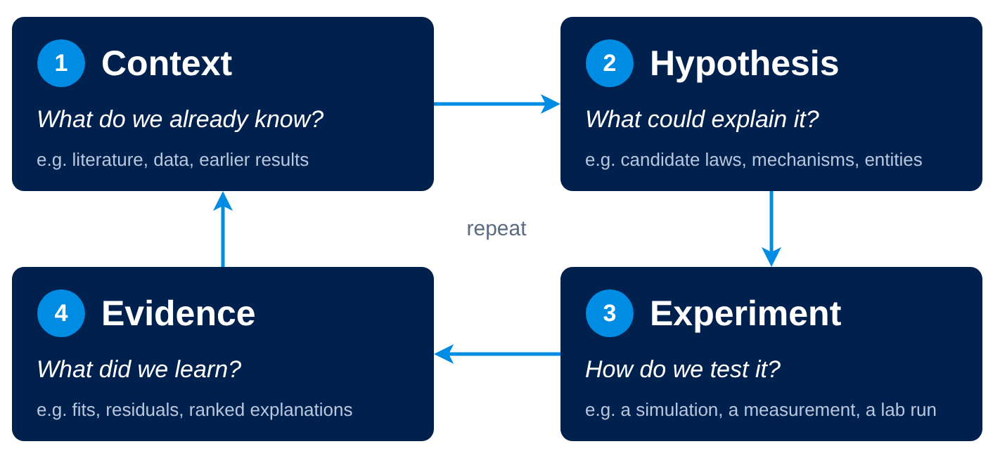
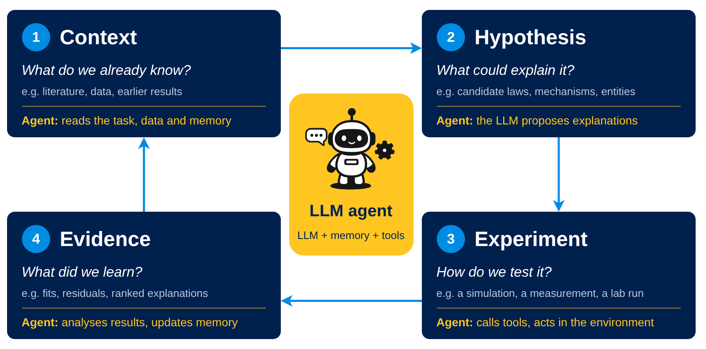
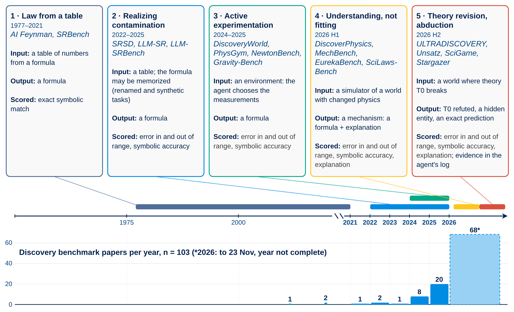
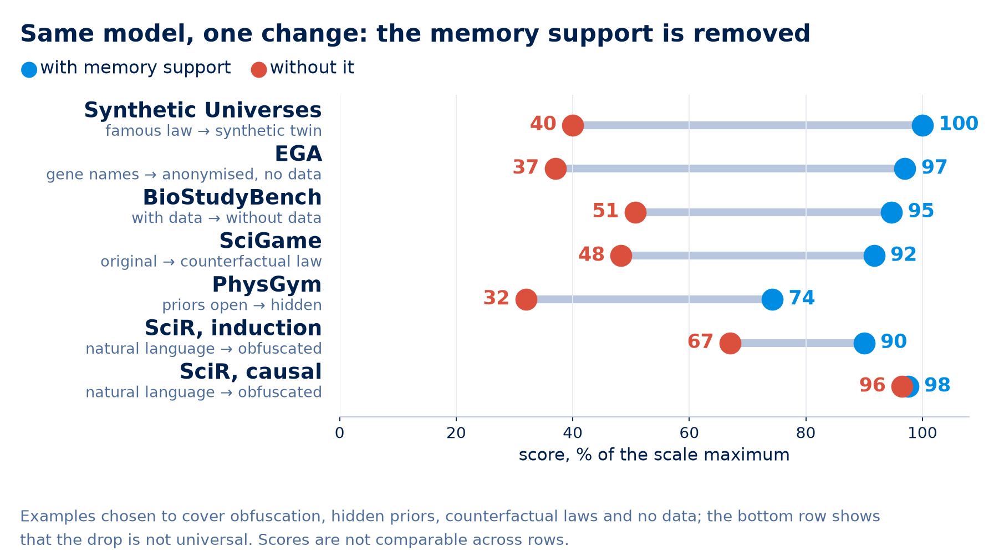

# Scientific Discovery Benchmarks for LLM Agents

What they measure, how they score, where the gaps are, and what a good benchmark needs

Mark Zaretskii

Do Androids Dream of Electric Papers? · Manchester, 25 Nov 2026

<!--
Survey (numbers as of 23 Nov 2026): 439 papers in the benchmark list; 296 classified with a single schema
(classification/), 81 of them from our full-text reviews; 103 of the 296 are discovery benchmarks (the deepest
required answer is fit 19, law 40, mechanism 40, structural 4); the chart on slide 2 counts exactly these 103.
Main question of the talk: can existing benchmarks distinguish
an agent that chooses an explanatory hypothesis from one that fits the data
or recalls the textbook?
-->

---

## The classical scientific loop

---

## An agent inside the loop

---

## 1. What we mean by epistemic abilities

omniscale-ai.github.io/epistemic_benchmarks

Discovery is a chain of steps, not a single answer:

1. **Notice an anomaly**: a known theory T0 stops working
2. **Propose alternatives**, including an unobservable entity (a hidden planet)
3. **Plan a discriminating experiment**: one where the hypotheses disagree
4. **Predict before measuring** and record the prediction
5. **Update confidence** in proportion to the strength of the evidence
6. **Derive a new prediction** from the mechanism, not by extending a fitted curve
7. **Know the domain of validity** of the law found
8. **Do not substitute memory for inference**

This is the lens for the rest of the talk: which steps benchmarks can see and which they cannot.

**We studied 103 discovery benchmarks.** By domain (one benchmark can span several): physics 31, biology 28, medicine 12, materials 12, chemistry 11, Earth science 9, math 9, social science and economics 9, astronomy 7, plus games, data science, software and general-purpose tasks.

---

## 2. How the field developed: five stages

omniscale-ai.github.io/epistemic_benchmarks

<!-- _footer: "Full references for all benchmarks named on this slide: see the Appendix." -->

<!--
Main lesson of each stage: 1 exact symbolic match; 2 numerical fit ≠ formula found; 3 memory protection becomes a
controllable axis; 4 good prediction ≠ correct mechanism; 5 models drop the axiom but do not introduce an
unobservable entity. What the agent does not know: 1 the formula (a human chose the variables); 2 a formula the
model may have seen; 3 the formula + which measurements to make; 4 the mechanism within a given language;
5 the language itself (T0 breaks, a new quantity or entity is needed).
Judges by benchmark: LLM-SRBench GPT-4o (130 tasks, 94.6% agreement); NewtonBench Nemotron-ultra-253b (120 pairs, 98.3%);
PhysGym gemini-2.5-flash as a fallback (one of the tested models); DiscoveryWorld GPT-4o for knowledge questions;
DiscoverPhysics claude-opus-4-6 (explanation 0-10, no validation); EurekaBench Claude Opus 4.8 + GPT 5.6 Sol with
access to the simulator (no quantitative validation); SciLaws-Bench GPT-5.4-mini with code (5 experts, kappa 0.77-0.84);
MechBench, Unsatz, Stargazer, Gravity-Bench: no judge; ULTRADISCOVERY Qwen3.8-27B (kappa 0.88 / 0.75 on 51 pairs);
SciGame GPT-6 Astra (one of the tested models). Source: literature/evaluation_methods.md.
The stages differ by question, not date: the finding on entities first came from DiscoverPhysics (May 2026).
Trends: from tables to environments with a budget, from public reference answers to generation from a private
seed, from a single score to separate scoring of prediction, mechanism and process.
Before LLMs (general knowledge, not from our corpus; check the years before the talk):
Lindley 1956 (Bayesian experimental design, expected information gain: the EIG metric); DENDRAL (1965, structures
from spectra) and MECHEM (reaction mechanisms with unobserved intermediates); BACON, STAHL, DALTON (Langley, Simon,
1977-87: laws from tables; BACON.4 "intrinsic properties", DALTON an unobservable composition); Swanson 1986
(literature-based discovery, ancestor of the post-cutoff defense); KEKADA 1988 (the urea cycle discovery:
experiment planning, reaction to surprise); PC/FCI and TETRAD (1990s, causal graphs, FCI allows hidden common
causes); Robot Scientist Adam (2004-09, closed loop in a real lab, experiments with a cost).
The memory problem had an analogue: the critique of BACON, the programmer chose the variables and the
representation; hidden things could be postulated only within a given vocabulary. Stage 5 asks whether LLMs go
beyond it. No benchmarks in the current sense then: the test was rediscovering historical cases.
Citations (snapshot of 12 Nov, 152 records): AI Feynman 1489 (growing as an SR method, not as an LLM benchmark), DiscoveryWorld 136,
DiscoveryBench 124; NewtonBench grew 10x+ in 2026. Of 37 papers with zero citations, 30 appeared in the last 3 months.
Stage 4 example: Synthetic Universes, Drag — prediction correct 5/5, mechanism 1/5; MechBench — law 35%, mechanism 13.75%.
The time axis is piecewise: 1950-2020 compressed, 2021-2026 stretched.
-->

---

<!-- _class: tight -->

## 3. What is required, how it is scored, and how memorization is excluded

omniscale-ai.github.io/epistemic_benchmarks

What the answer has to explain, how it is scored and where that goes wrong. Depth is set by the check, not by the form of the answer:

| Depth | What is checked | Orbit example | What is scored | Pitfall |
|---|---|---|---|---|
| fit | parameter values for a given form | k = 3.2 in T² = k·a³ | point estimate of the parameters | cannot tell the right form from a wrong form that fits well |
| law | prediction of **observables** outside the training range | T² ∝ a³ (Kepler) | score on the trajectory (plus the form of the law) | good in range, bad out of range; too many parameters; the form needs a validated judge wherever code cannot check equivalence |
| mechanism | **hidden** quantities and the response to an intervention | force ∝ 1/r² on a hidden mass M (the Sun) and F = ma | trajectory + symbolic form + explanation of the mechanism | the same, and the mechanism often needs a judge that must be calibrated against humans |
| structural | choice between rival structures | new planet or new law? | full explanation: the choice and its grounding in evidence | the explanation may disagree with the fit and the mechanism; almost no benchmark scores it |

Memory is separated from inference by a ladder of versions of the same task:

| Rung | What it is | Example: gravity | Role of memory |
|---|---|---|---|
| (a) historical | real names and laws | Earth and Moon, F ∝ 1/r² | helps |
| (b) obfuscated | same law, names and units hidden | bodies X and Y, unnamed quantities | helps if recognized |
| (c) counterfactual | a recognizable textbook law deliberately changed | "gravity", but F ∝ 1/r^2.6 | **hurts**: pulls toward the textbook |
| (d) synthetic | a world with no real prototype | invented force from an invented "charge" | neutral |

- a − b is recognition from text; b − c is how much comes from memory rather than data; c vs d is the cost of the textbook's pull

---

## 4. Saturation: a high score on the familiar version hides a drop

omniscale-ai.github.io/epistemic_benchmarks

<!-- _footer: "Full references for all benchmarks named on this slide: see the Appendix." -->

---

## 5. Typical agent failure modes

omniscale-ai.github.io/epistemic_benchmarks

<!-- _footer: "Full references for all benchmarks named on this slide: see the Appendix." -->

| Problem | Example in a benchmark |
|---|---|
| **They guess from general regularities** | **BioStudyBench:** one model (GPT-6 Sol), seeing only the question, correctly guesses direction and significance for 83% of non-null post-cutoff findings (16% for null ones); a cutoff protects against lookup, not against guessing |
| **They fit rather than find the law** (the answer matches the data seen but has the wrong form and breaks on unseen data) | **Synthetic Universes:** pendulum described as a linear oscillator with NRMSE 0.0016, rejected over a wider range of angles; in Drag the agent itself estimated p ≈ 1.54 but submitted a linear law. **CodeARC:** o3-mini's first function passes visible examples in 67.6%, hidden tests in 38.9% |
| **They collect the evidence but do not use it** | **LUCA:** discriminating observation in 91% of sessions, correct diagnosis in 30%. **Solution Injection:** hint noticed in 79–97%, used in 0.5–50% |
| **They miss the anomaly** | **LongChang:** discovery rate 0% for 11 of 12 models. **Gravity-Bench:** o4-mini never acknowledges the violation of Kepler's law (0/18, our recount) |
| **They notice the deviation but do not postulate an entity** | **DiscoverPhysics:** no run of the best models proposed hidden sources. **ULTRADISCOVERY:** the axiom is rejected in 46.1% of Open episodes, but no episode postulates a hidden label |
| **They take the right actions but do not draw the conclusion** | **DiscoveryWorld:** for GPT-4o process 0.49–0.64, completion 0.08–0.38, knowledge 0.01–0.34 |

---

## 6. Typical defects of the benchmarks themselves

omniscale-ai.github.io/epistemic_benchmarks

<!-- _footer: "Full references for all benchmarks named on this slide: see the Appendix." -->

| Defect | Example in a benchmark |
|---|---|
| **Correctness feedback before submission** turns the task into search against an oracle | **Stargazer, Witness, CodeARC, PhysGym:** `is_correct` is available in the episode |
| **Reference leaks** | **NewtonBench:** the law can be imported from the sandbox. **Gravity-Bench:** a hint in the file name `Drag tau = 1.7e9.csv` |
| **Hints about the form** | **Gravity-Bench:** gives r^−(2+α) in the prompt, so the counterfactual reduces to fitting one parameter |
| **A correct answer that cannot be scored as correct** | **Stargazer:** "0 planets" gets no credit by construction of the metric |
| **Metrics that mislead** | **LLM-SRBench:** NaNs dropped from NMSE. **ULTRADISCOVERY:** a binary outcome where everyone scores 0 |
| **Reproducibility** | In 11 of 81 full reviews the code is not published; inconsistent numbers in **SciGame, SLDBench, BoxingGym, ERBench, HypoArena** |

---

## 7. What a good discovery benchmark needs

omniscale-ai.github.io/epistemic_benchmarks

Lessons from the failure modes and defects above:

1. **No-data probe** on every task, with the same tools, and "undetermined" as an allowed answer
2. **Paired tasks:** the same anomaly; one needs a new entity, the other does not
3. **Rungs a → b → c → d on one task**, so the drop shows the contribution of memory
4. **Precommitment:** hypothesis and forecast recorded machine-readably before each measurement; score the share of discriminating measurements and the consistency of updates
5. **No correctness feedback** before submission; the reference stays outside the sandbox
6. **Test the law on unseen conditions** (outside the range, interventions), and the form of the law separately
7. **Explanation on two axes:** grounding in the agent's log with quotes, and match with the reference
8. **Baselines:** constant answers, the no-data answer, a non-LLM solver, an oracle
9. **Judges** from a different family, κ compared against human–human agreement

**Summary:** an agent's epistemics should be measured by process, paired cases and memory decomposition, not by the final answer.

---

<!-- _class: title -->

# Thank you for your attention

omniscale-ai.github.io/epistemic_benchmarks

---

## Appendix. References

omniscale-ai.github.io/epistemic_benchmarks

- **AI Feynman**: Udrescu & Tegmark (2020). AI Feynman: a Physics-Inspired Method for Symbolic Regression. arXiv:1905.11481
- **BioStudyBench**: Li, Karim & Gensbigler (2026). BioStudyBench: Evaluating Agents on Post-Cutoff Biomedical Studies. arXiv:2610.07614
- **BoxingGym**: Gandhi et al. (2025). BoxingGym: Benchmarking Progress in Automated Experimental Design and Model Discovery. arXiv:2501.01540
- **CodeARC**: Wei et al. (2025). CodeARC: Benchmarking Reasoning Capabilities of LLM Agents for Inductive Program Synthesis. arXiv:2503.23145
- **DiscoverPhysics**: Wiemann et al. (2026). DiscoverPhysics: Benchmarking LLMs for Out-of-the-Box Scientific Thinking. arXiv:2605.26087
- **DiscoveryWorld**: Jansen et al. (2024). DiscoveryWorld: A Virtual Environment for Developing and Evaluating Automated Scientific Discovery Agents. arXiv:2406.06769
- **EGA**: Zhang & Li (2026). Are We Measuring Scientific Intelligence? Rethinking the Evaluation of AI Scientists. arXiv:2610.04915
- **ERBench**: Kahlmeyer et al. (2026). ERBench: A Benchmark and Testsuite for Equation Discovery Algorithms. arXiv:2606.09276
- **EurekaBench**: Geng et al. (2026). EurekaBench: Measuring Agentic Ability to Discover New Scientific Insights. arXiv:2610.00492
- **Gravity-Bench**: Koblischke et al. (2025). Gravity-Bench-v1: A Benchmark on Gravitational Physics Discovery for Agents. arXiv:2501.18411
- **HypoArena**: Zhong et al. (2026). Before the Action: Benchmarking LLMs on Prospective Hypothesis Discovery. arXiv:2607.15766
- **LLM-SR**: Shojaee et al. (2024). LLM-SR: Scientific Equation Discovery via Programming with Large Language Models. arXiv:2404.18400
- **LLM-SRBench**: Shojaee et al. (2025). LLM-SRBench: A New Benchmark for Scientific Equation Discovery with Large Language Models. arXiv:2504.10415
- **LongChang**: Yang et al. (2026). Can LLMs Uncover Hidden Physical Laws through Free Exploration?. arXiv:2610.37649
- **LUCA**: Gogleva et al. (2026). LUCA: A Synthetic World for Experimental Reasoning. arXiv:2611.03100
- **MechBench**: Yu et al. (2026). MechBench: Can AI Scientific Agents Discover Mechanisms Beyond Phenomenal Laws?. arXiv:2609.35515
- **NewtonBench**: Zheng et al. (2025). NewtonBench: Benchmarking Generalizable Scientific Law Discovery in LLM Agents. arXiv:2510.07172
- **PhysGym**: Chen et al. (2025). PhysGym: Benchmarking LLMs in Interactive Physics Discovery with Controlled Priors. arXiv:2507.15550
- **SciGame**: Zhao et al. (2026). SciGame: Let Agents Play the Scientific Discovery Games in the Real and Counterfactual World. arXiv:2610.37919
- **SciLaws-Bench**: Huang et al. (2026). Can LLMs Discover Scientific Laws in Real and Parallel Worlds?. arXiv:2609.01552
- **SciR**: Beckmann et al. (2026). SciR: A Controllable Benchmark for Scientific Reasoning in LLMs. arXiv:2606.13020
- **SLDBench**: Lin et al. (2025). Can Language Models Discover Scaling Laws?. arXiv:2507.21184
- **Solution Injection**: Engländer et al. (2026). Agents Explore but Agents Ignore: LLMs Lack Environmental Curiosity. arXiv:2604.17609
- **SRBench**: La Cava et al. (2021). Contemporary Symbolic Regression Methods and their Relative Performance. arXiv:2107.14351
- **SRSD**: Matsubara et al. (2022). Rethinking Symbolic Regression Datasets and Benchmarks for Scientific Discovery. arXiv:2206.10540
- **Stargazer**: Liu et al. (2026). Stargazer: A Scalable Model-Fitting Benchmark Environment for AI Agents under Astrophysical Constraints. arXiv:2604.15664
- **Synthetic Universes**: Chauhan (2026). Can AI Scientists Change Their Minds? Prior–Evidence Conflict in Synthetic Universes. arXiv:2609.36726
- **ULTRADISCOVERY**: Li et al. (2026). UltraDiscovery: Abductive Exploration in an Interconnected, Epistemically Open Universe. arXiv:2610.03092
- **Unsatz**: Ji, Wang & Sun (2026). Unsatz: Evaluating Scientific Discovery Without a Given Ansatz. arXiv:2611.03713
- **Witness**: Ning et al. (2026). Witness: Discovery, Deciphering, and Epiphany in Interactive Puzzle Environments. arXiv:2609.32208

